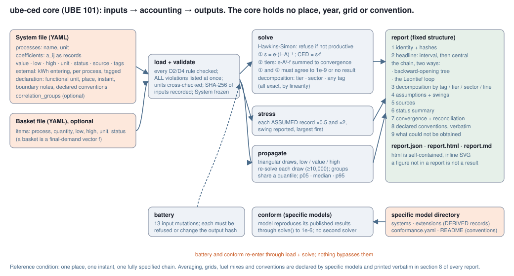

# ube-ced

**Energy accounting for survival goods and services, at a fully specified reference condition.**
The core tool of the Universal Basic Energy (UBE) project. UBE 101.

[](https://doi.org/10.5281/zenodo.23651855)
[](https://github.com/djboy26/ube-ced/actions)
Code MIT · data and documents CC-BY-4.0



## The one equation

```
ε = e · (I − A)⁻¹        kWh of external energy per unit of each process
CED(f) = ε · f           kWh of external energy per functional unit (a good, a service, a basket)
```

`A` holds the recipes (units of input *i* per unit of output *j*), `e` the energy that enters the chain
from outside at each process, `f` what is demanded. The inverse resolves the infinite upstream regress
(flour needs electricity needs steel needs electricity …) in one operation.

## What the core is, and is not

| The core holds | The core does not hold |
|---|---|
| The accounting formalism at **one place, one instant, one fully specified chain** | Any country, year, grid, fuel mix, PEF, averaging rule, renewable convention, boundary preference |
| Records with provenance: every number carries unit, status (MEASURED / DATABASE / DERIVED / ASSUMED), source, low/high | Bare floats |
| Two implementations of the solve that must agree to 1e-9 | A second solver anywhere else |
| Uncertainty in as three numbers, out as percentiles (≥ 10,000 draws) | Point values reported alone |
| Exact decomposition by tier, by sector, and by **any tag** on the external energy | An opinion on what the tags should be |
| A fixed nine-part report, generated, with the two mandatory depictions | Prose results |
| A corruption battery and a conformance check for specific models | Heuristics |

Everything in the right-hand column is declared by a **specific model** and printed verbatim in section 8
of its report. The specification is `docs/SPEC_v2_core.md`; the one-page version is `docs/CORE.md`.

## Try it in two minutes

```bash
pip install -e ".[test]"
cd examples/reference_condition
ube-ced run system.yaml --out out
open out/report.html          # or xdg-open / start
```

The example is a **fictional** town on one winter noon: bread, water, heat, electricity, transport and a
clinic visit for one person-day, with the loops (steel ↔ electricity ↔ diesel) that make the inverse
necessary. Every number in it is ASSUMED and says so. It exists to show the mechanism, not to claim anything.

What the report shows for it: 35 – 49 kWh external energy per person-day (central 41), of which 9.7 kWh
tagged `stock` and 31.4 kWh tagged `flow`; plain addition would miss 3.3 kWh (8 %); the largest assumption
swing is the heating line (79 %). Change a number, re-run, the report regenerates.

```bash
ube-ced run system.yaml --basket basket_vulnerable_day.yaml --out out_v    # your own basket
ube-ced battery system.yaml                                               # 13 mutations, all must be caught
ube-ced conform .                                                         # reproduces its pinned results
```

## Writing your own system

One YAML file. Three required blocks plus the declaration. See `examples/reference_condition/system.yaml`
for every field with comments. The loader refuses with **all** violations listed at once; fix them together.

- `processes`: name and unit.
- `coefficients`: one record per input→output, `value`/`low`/`high`, `unit` as `input_unit/output_unit`, `status`, `source` unless ASSUMED, optional `tags`.
- `external`: kWh entering the chain per unit of a process's output, with the same fields; `tags` here drive the tag decomposition.
- `declaration`: functional unit, place, instant, boundary notes, and a list of named conventions with reasons.

A basket is a second small YAML of lines (process, quantity, low, high, unit, status). Or make the basket a
process of its own, as the example does with `PersonDay`, and the tree opens from it.

## Specific models

`model/wave4/ube_model_v5/` is the project's Danish survival-floor model, frozen as published in Sept 2026
(63 lines, Statistics Denmark IO tables, dwelling heat balance). It is the first conformance target: the core
is complete when `conform()` reproduces its 189 result cells with no edit to v5. That adapter is the next
stage. Its figures (6,761 kWh/person/yr on the DK-2023 grid, PROVISIONAL) are specific-model outputs,
not core outputs. See `docs/CANONICAL_FIGURES.md` for the project's figures and withdrawals.

## Repository map

| Path | What |
|---|---|
| `ube_ced/` | the core: `records`, `system`, `solve`, `stress`, `propagate`, `scenario`, `report`, `diagrams`, `battery`, `conform`, `cli` |
| `examples/reference_condition/` | the fictional worked example and its own conformance file |
| `examples/legacy_v01/` | the v0.1 six-sector toy, kept for `docs/ERRATA.md` |
| `model/` | the Danish v5 model and the reference files its regression battery reads |
| `docs/` | `CORE.md`, `SPEC_v2_core.md`, `CANONICAL_FIGURES.md`, `ERRATA.md`, `OPEN_QUESTIONS.md`, `METHOD.md` |
| `tests/` | core tests; v5 regression wrapper |

## Cite

`CITATION.cff`. Concept DOI https://doi.org/10.5281/zenodo.23651855 resolves to the latest release.

Sourabh Jogalekar, Universal Basic Energy project. sourabhrj26@gmail.com
